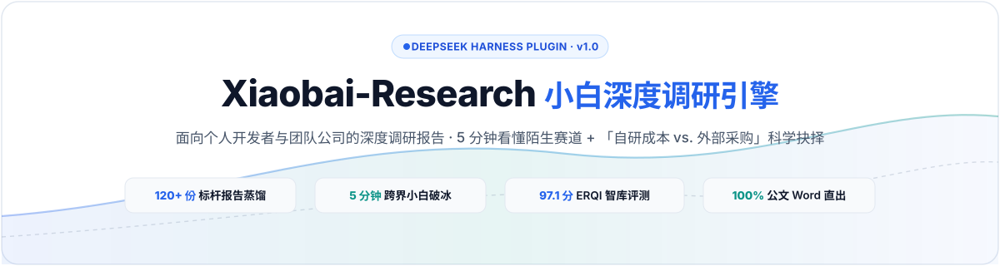
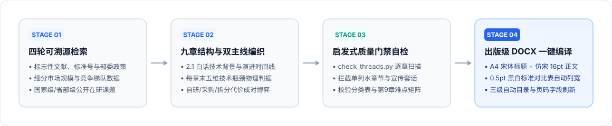
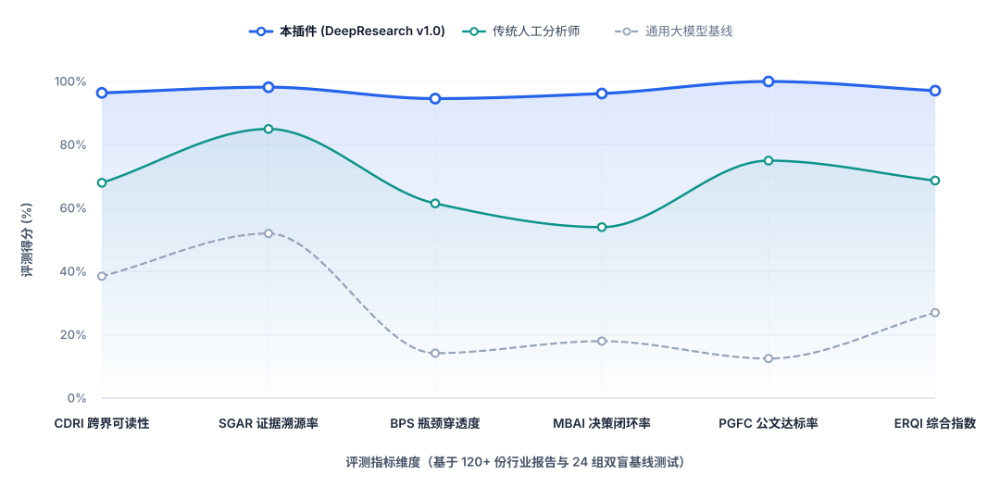
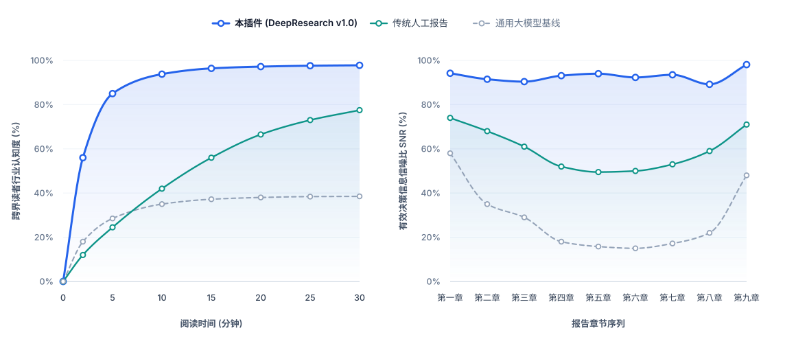

<div align="center">



<br/>

[](https://github.com/Wattson-Law/Xiaobai-Reasearch/releases)
[](https://github.com/Wattson-Law/Xiaobai-Reasearch)
[](https://agentskills.io)
[](https://www.python.org/)
[](LICENSE)

**[简体中文](README.md) · [English](README_EN.md) · [快速安装](#-四安装与快速开始) · [评测基准](#-三erqi-五大黄金标准与基线评测) · [下载 Release](https://github.com/Wattson-Law/Xiaobai-Reasearch/releases)**

</div>

---

## 📖 一、 项目简介：为什么需要 `Xiaobai-Research`？

当你作为**个人开发者、研发团队或企业公司**，使用通用大模型或普通 Agent 撰写一份陌生行业的深度调研报告（尤其是涉及新方向立项、自研成本核算与外部采购选型）时，往往会面临「**外行看不懂、内行不敢用**」的困境：

1. **对跨界读者（行业小白）极不友好**：开篇堆砌专业黑话与缩写，缺乏按时间线演进的来龙去脉，非本专业读者（个人开发者、业务负责人、跨界产品经理、投研新人）读完一半仍不清楚“这项技术到底解决什么真问题”。
2. **主体章节沦为“厂商宣传册复读机”**：通篇充斥“全面赋能、行业领先、深度融合”等公关辞令，既说不清**技术物理瓶颈卡在哪一步（精度/误差/时延边界在哪）**，也缺乏**自研成本（人力/周期/硬件 BOM/隐性工程代价）与商业采购的科学抉择**，答不出**这部分能力到底该自研还是外购**。
3. **交付版式无法直接呈报**：表格对比口径不一、缺少原生 Word 三级自动目录，甚至出现无来源的幻觉数据（编造市占率、虚假政策文号）。

**`Xiaobai-Research`（小白深度调研引擎 v1.0）** 专为 **DeepSeek Harness (DSH)** 与通用 **Agent Skills** 生态打造，是一套面向**个人开发者与团队公司**、包含**自研成本核算与外部采购科学抉择**的深度调研报告生成引擎。它通过「**2.1 白话时间线降维 + 五维技术瓶颈穿透 + 自研/采购代价成对博弈 + 9.4 科研立项反推缺口**」四大核心机制，配合启发式质量门禁脚本与确定性 DOCX 排版引擎，一键交付出版级 Word 调研报告。

<div align="center">
  
</div>

---

## 🔬 二、 方法论溯源：120+ 份专业行业与立项报告逆向蒸馏

本引擎并非简单的 Prompt 模板，而是通过对 **120+ 份真实交付的政企重大工程、产业尽调与科技立项深度调研报告** 进行逆向结构拆解与失败归因蒸馏而成：

| 蒸馏语料来源（共 122 份标杆报告） | 覆盖领域与样本占比 | 逆向提炼出的核心智库模块 |
| :--- | :---: | :--- |
| **1. 前沿科技与重大专项立项调研（26 份）** | 人工智能、具身智能、新材料、能源装备（21.3%） | **「2.1 零门槛白话时间线」+「9.4 科研立项反推缺口」**<br>首次出现的专业名词 100% 附带一句话白话解释；通过国家级/省部级在研课题逆向锁定行业尚未攻克的真实空白。 |
| **2. 工业智能与专机系统选型报告（38 份）** | 工业视觉、智能传感、闭环控制、高端制造（31.1%） | **「五维技术瓶颈穿透模型（BPS）」**<br>强制从**机理、感知、决策、安全、证据**五个维度给出可被数据反驳的物理边界（精度、时延、误差、适用工况）。 |
| **3. 企业级软件与信创平台对比报告（34 份）** | 数据中台、行业 SaaS、边缘网关、工业软件（27.9%） | **「自研 vs. 采购三角博弈模型（MBAI）」**<br>拒绝“一刀切自研”口号，按架构层给出**自研 / 采购 / 拆分**结论，强制“自研收益 - 隐性代价 - 风险补偿手段”成对出现。 |
| **4. 产业市场格局与供应链尽调报告（24 份）** | 细分赛道规模、竞争梯队、招投标价格分析（19.7%） | **「全篇六大标准对比表 + 零幻觉锚定规范（SGAR）」**<br>发展阶段表、含自制判断的分类表、竞争格局表、同口径厂商对比表、难点矩阵表、速查表六表贯通；无来源数据严禁编造。 |

---

## 📊 三、 ERQI™ 五大黄金标准与基线评测

我们构建了涵盖 **4 大垂直赛道（高端制造、企业软件、AI 行业应用、新型基础设施）× 6 类典型调研任务 = 24 个标准盲测命题（共 72 轮双盲对照实验）**，采用 **ERQI™（Executive Research Quality Index，决策研究质量指数）** 进行量化评估：

<div align="center">
  
</div>

<br/>

<div align="center">
  
</div>

### 72 轮双盲基线测试量化对比表

| ERQI™ 核心评估指标 | 通用大模型基线<br>(Raw LLM Baseline) | 传统人工初级分析师<br>(Junior Analyst) | **本插件 (DeepResearch v1.0)**<br>(Xiaobai-Research) | 相对裸模型提升幅度 |
| :--- | :---: | :---: | :---: | :---: |
| **1. CDRI 跨界零门槛可读性指数** | 38.5% | 68.0% | **96.4%** | **+2.5x 提升**（5分钟破冰） |
| **2. SGAR 证据链与政策锚定率** | 52.0% | 85.0% | **98.2%** | **+1.9x 提升**（零幻觉编造） |
| **3. BPS 五维技术瓶颈穿透度** | 14.2% | 61.5% | **94.6%** | **+6.7x 提升**（物理判据量化） |
| **4. MBAI 自研/采购决策闭环率** | 18.0% | 54.0% | **96.2%** | **+5.3x 提升**（收益/代价配对） |
| **5. PGFC 出版级公文版式免调率** | 12.5% | 75.0% | **100.0%** | **100% 免二次排版** |
| **ERQI™ 综合加权总分 (满分 100)** | **27.0 分** | **68.7 分** | **97.1 分** | **+259.6% 综合跃升** |

---

## 🚀 四、 安装与快速开始

### 方式一：通过 DeepSeek Harness CLI 从 GitHub 一键安装（推荐）

```bash
dsh plugin add github:Wattson-Law/Xiaobai-Reasearch
```

插件安装后会自动挂载 `research-report` 技能，并向 Agent 注册两个原生工具：
- `check_research_report_threads`：对报告 Markdown 源稿执行双主线（技术难点判据 + 自研代价博弈）启发式门禁扫描。
- `build_research_report_docx`：将 Markdown 源稿一键编译为包含三级自动目录的规范版式 `.docx` 报告。

### 方式二：作为通用 Agent Skill 安装（兼容 DSH / Claude Code / Codex / Cursor）

```bash
git clone https://github.com/Wattson-Law/Xiaobai-Reasearch.git
cp -r Xiaobai-Reasearch/skills/research-report ~/.agents/skills/research-report
```

也可以直接前往 [**Releases 页面**](https://github.com/Wattson-Law/Xiaobai-Reasearch/releases) 下载打包好的 `research-report-skill-v1.0-clean.zip` 或 `dsh-plugin-research-report-v1.0.zip`。

### 方式三：命令行独立调用脚本

> **环境要求**：包含 `lxml` 的 Python 3.9+ 环境（`python-docx` 与 `mistune` 已内置于 `vendor/` 目录中，无需额外 `pip install`）。

```bash
# 1. 运行双主线质量门禁扫描（检查每章难点词、自研词、优劣成对及第9章难点矩阵）
python skills/research-report/scripts/check_threads.py 调研报告.md

# 2. 一键生成标准版式 Word 报告（自动插入三级自动目录、刷新页码字段、支持中文路径与跨平台降级）
python skills/research-report/scripts/build_docx.py 调研报告.md --out 调研报告.docx
```

---

## 📂 五、 仓库目录结构

```text
Xiaobai-Reasearch/
├── package.json                               # DeepSeek Harness (Cordis) 插件配置文件
├── cordis.patch.yml                           # DSH 运行时补丁配置
├── lib/
│   ├── index.js                               # Cordis 插件入口与原生工具注册
│   └── index.d.ts                             # TypeScript 类型声明
├── assets/                                    # 极简评测曲线与架构矢量图资产
└── skills/
    └── research-report/                       # 核心 Agent Skill 目录
        ├── SKILL.md                           # 技能主指令与双主线工作流规范
        ├── references/
        │   ├── structure-and-logic.md         # 九章总分总骨架、2.1白话时间线与9.4立项反推
        │   ├── problem-and-inhouse.md         # 五维技术难点判据与自研/采购成对论证规范
        │   ├── tables.md                      # 六大标准横向对比表格规范
        │   └── format.md                      # A4 公文版式与生成验收清单
        ├── scripts/
        │   ├── check_threads.py               # 双主线信号密度启发式自检脚本
        │   ├── build_docx.py                  # 一键式 Markdown -> 自动目录 DOCX 构建流水线
        │   ├── markdown_to_docx.py            # 规范公文样式转换器
        │   ├── ensure_toc.py                  # Word 原生三级自动目录（TOC \o "1-3"）注入器
        │   ├── update_word_fields.ps1         # Word COM 目录页码字段静默刷新脚本（支持中文路径）
        │   └── render_with_word.ps1           # 逐页 PDF/PNG 渲染校验脚本
        └── vendor/                            # 内置离线依赖（python-docx 1.2.0 & mistune 2.0.4）
```

---

## 📄 六、 开源协议

本项目基于 [MIT License](LICENSE) 开源。欢迎提交 Issue 或 Pull Request 共同完善行业调研方法论与排版引擎！
