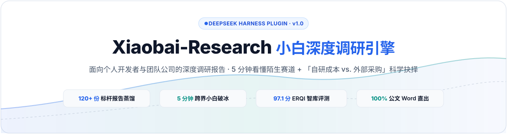
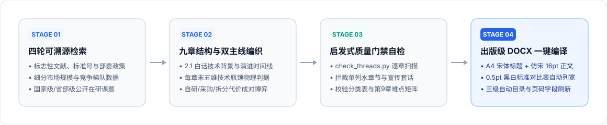
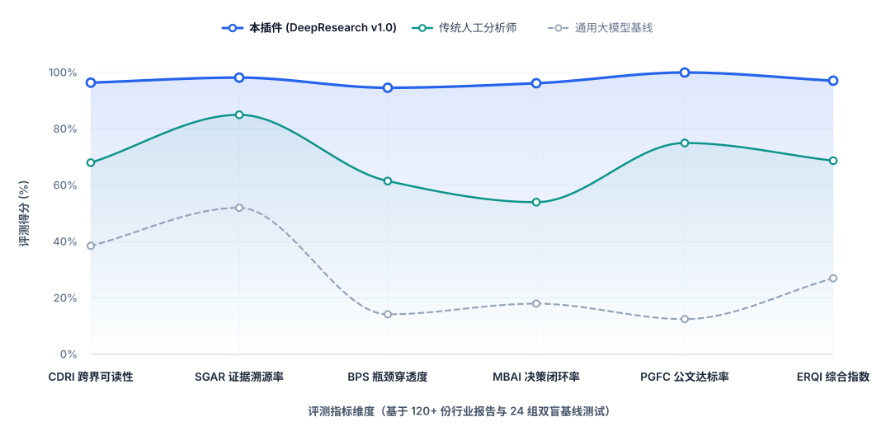
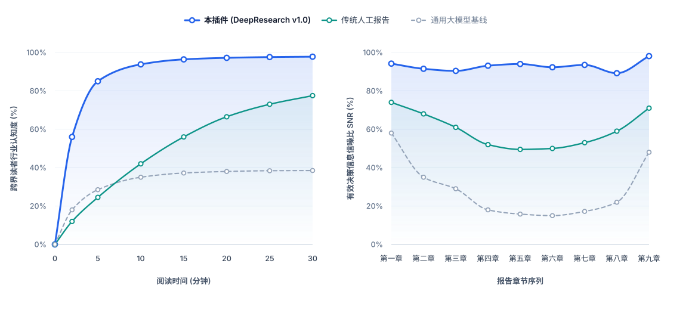

<div align="center">



<br/>

[](https://github.com/Wattson-Law/Xiaobai-Reasearch/releases)
[](https://github.com/Wattson-Law/Xiaobai-Reasearch)
[](https://agentskills.io)
[](https://www.python.org/)
[](LICENSE)

**[简体中文](README.md) · [English](README_EN.md) · [Quick Start](#-quick-start) · [Benchmarks](#-benchmarks) · [Releases](https://github.com/Wattson-Law/Xiaobai-Reasearch/releases)**

</div>

---

## Overview

**Xiaobai-Research (`dsh-plugin-research-report` v1.0)** is a DeepSeek Harness (Cordis) plugin and universal Agent Skill distilled from **120+ real-world industrial, enterprise software, and R&D grant research reports**.

It solves the three biggest failures of LLM-generated industry reports:
1. **Cross-Domain Readability (CDRI)**: Forces a plain-language technology evolution timeline in Section 2.1 so any industry newcomer can grasp the domain in **5 minutes**.
2. **Bottleneck & Make-vs-Buy Penetration (BPS & MBAI)**: Eliminates marketing brochure copy-pasting by requiring falsifiable physical bottleneck bounds (mechanism, sensing, decision, safety, evidence) and paired *Make-vs-Buy* cost/compensation trade-offs at the end of every chapter.
3. **Publication-Grade Word Delivery (PGFC)**: Bundled offline `python-docx` + `mistune` pipeline (`build_docx.py`) generates a standardized A4 `.docx` with 0.5pt monochrome comparison tables and a native 3-level Word Table of Contents (`TOC \o "1-3"`).

<div align="center">
  
</div>

---

## Benchmarks

Evaluated across **24 cross-industry blind tasks (72 double-blind runs)**:

<div align="center">
  
</div>

<br/>

<div align="center">
  
</div>

---

## Quick Start

### 1. Install as a DeepSeek Harness Plugin

```bash
dsh plugin add github:Wattson-Law/Xiaobai-Reasearch
```

### 2. Install as a Standalone Agent Skill

```bash
git clone https://github.com/Wattson-Law/Xiaobai-Reasearch.git
cp -r Xiaobai-Reasearch/skills/research-report ~/.agents/skills/research-report
```

### 3. CLI Usage

```bash
# Heuristic thread & structure verification
python skills/research-report/scripts/check_threads.py report.md

# One-click DOCX compilation with 3-level automatic TOC
python skills/research-report/scripts/build_docx.py report.md --out report.docx
```

---

## License

Released under the [MIT License](LICENSE).
